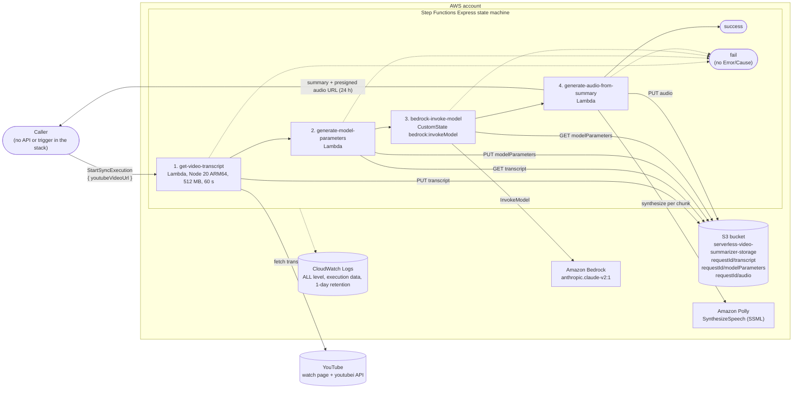
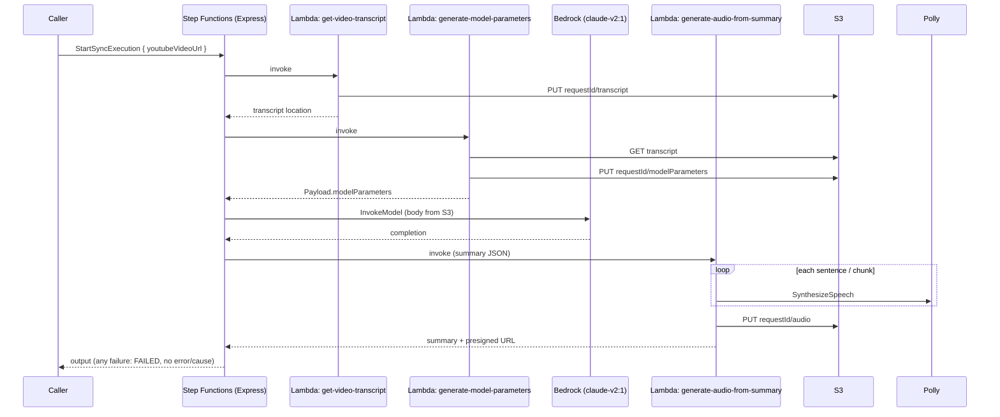

# Architecture diagram

Mermaid diagram of the deployed system, derived from `infra/lib/infra-stack.ts` and `src/`. GitHub renders it inline. Findings referenced here (WF-1 and so on) are in [architecture-review.md](./architecture-review.md).

## Sequence view

