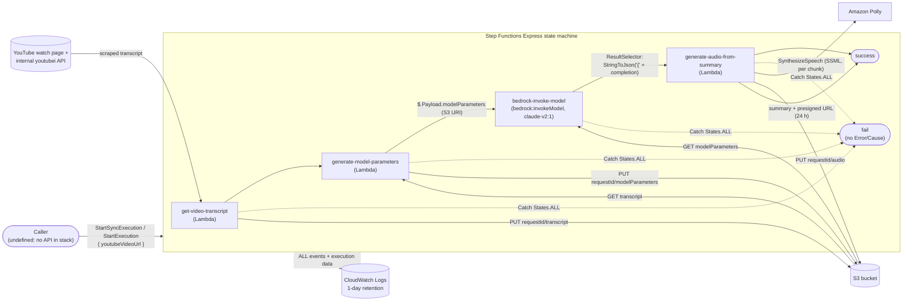

# Architecture review: YouTube video summarizer

Reviewed at commit `7c01c9e` (branch `main`). The review is read-only. No code or infrastructure was changed.

Severities assume the system is a **production candidate**. Where a demo could reasonably accept a finding as it is, the finding is marked *acceptable for demo*.

How findings were checked:

- Every finding was checked against the source files listed in the evidence.
- The stack was synthesized locally with `cdk synth` (CDK 2.117.0) to confirm the generated state machine definition (ASL) and IAM policies. That run created no files in the repository.
- The existing Jest suite was run (`infra/`, 1 placeholder test, passes).
- AWS limits are cited with links to the AWS documentation. The documentation was not fetched live during this review, so re-check the quoted values before acting on them.

## 1. Architecture summary

The stack is a single CDK stack (`infra/lib/infra-stack.ts`) with these parts:

- **Step Functions Express state machine** (`infra/lib/infra-stack.ts:151-162`). It runs four tasks in sequence, and every task catches `States.ALL` into one `Fail` state.
- **Three Node.js 20 / ARM64 Lambdas** (512 MB, 60 s timeout). They share `lambdaConfig` (`infra/lib/infra-stack.ts:42-49`).
- **A direct Bedrock `InvokeModel` integration** for `anthropic.claude-v2:1`, which reads its request body from S3 (`infra/lib/infra-stack.ts:124-141`).
- **Amazon Polly** neural TTS, called from the last Lambda.
- **One S3 bucket**, `serverless-video-summarizer-storage`. Objects are keyed `<executionName>/transcript`, `/modelParameters` and `/audio`.

The application code (`src/`) splits handlers (`src/lambda-handlers/*`) from adapters (`src/adapters/*`: S3 repositories and Polly).

## 2. Findings

Each finding lists its severity, evidence, impact and recommendation. The IDs are used in section 3.

### 2.1 Workflow design and failure handling

**WF-1. The failure path discards the error and returns nothing useful. High.**

- Evidence:
  - `infra/lib/infra-stack.ts:104` creates `new Fail(this, "fail")` with no `error` or `cause`.
  - Each `.addCatch(failState)` (`:114`, `:121`, `:142`, `:146`) uses the default `ResultPath` (`$`). The error object becomes the input of the `Fail` state, but a `Fail` state does not output its input.
- Impact:
  - Every failure looks the same to the caller: status `FAILED` with no error and no cause.
  - The only way to find out which step failed is to read the execution logs (see OBS-2).
  - The catch-all also hides the difference between errors worth retrying and permanent ones.
- Recommendation:
  - Either remove the catch-all so the original error and cause reach the caller, or route each catch to a `Fail` state that sets `errorPath`/`causePath` (`$.Error`, `$.Cause`).
  - Return a stable error contract, for example `TRANSCRIPT_UNAVAILABLE`, `MODEL_OUTPUT_INVALID` or `TTS_FAILED`.

**WF-2. Bedrock and Lambda throttling are not retried. High.**

- Evidence:
  - The Bedrock `CustomState` (`infra/lib/infra-stack.ts:124-141`) has no `Retry`. The synthesized ASL confirms that the state has only a `Catch`.
  - CDK's `LambdaInvoke` adds a default retry for `Lambda.ClientExecutionTimeoutException`, `Lambda.ServiceException`, `Lambda.AWSLambdaException` and `Lambda.SdkClientException` (6 attempts, 2 s interval, backoff 2). This was confirmed in the synthesized template.
  - That default list does not include `Lambda.TooManyRequestsException`, `States.Timeout`, or the errors that come from inside the handlers (S3, Polly and YouTube calls).
- Impact:
  - Bedrock on-demand quotas (requests and tokens per minute) are low by default for Claude models. Any throttle (`Bedrock.ThrottlingException`) or transient `Bedrock.ServiceUnavailableException` fails the whole run immediately.
  - The same applies to Lambda concurrency throttles.
- Recommendation:
  - Add a `Retry` on the Bedrock state for `Bedrock.ThrottlingException`, `Bedrock.ServiceUnavailableException` and `Bedrock.ModelTimeoutException`, with jittered backoff (`JitterStrategy.FULL`).
  - Add `Lambda.TooManyRequestsException` to the Lambda retries.
  - Keep the total retry budget inside the 5-minute Express limit (REL-1).

**WF-3. Parsing the model output in ASL is fragile and nothing validates it. High.**

- Evidence:
  - The prompt pre-fills the assistant turn with `{` (`src/lambda-handlers/generate-model-parameters.ts:36`).
  - The state machine rebuilds the JSON with `States.StringToJson(States.Format('\{{}', $.Body.completion))` (`infra/lib/infra-stack.ts:137-138`).
  - The audio Lambda trusts the shape `{ speakers: string[]; topics: string; summary: string[] }` without checking it (`src/lambda-handlers/generate-audio-from-summary.ts:7-8`, `:19-26`).
- Impact:
  - The parse fails if the completion has any text after the closing brace, is cut off at `max_tokens_to_sample` (4000, `src/adapters/model-parameters-repository.ts:4`), or contains invalid JSON. The run then fails inside `ResultSelector` with an intrinsic-function or runtime error. AWS documents `States.Runtime` as not catchable, so depending on the error type, the `Catch` may not even run.
  - If the JSON is valid but `summary` is missing or not an array, `synthesize` throws (`for … of undefined`). That wastes the Bedrock spend.
- Recommendation:
  - Move parsing and validation into a Lambda (or into the audio Lambda), using a schema validator such as zod. Strip any text outside the outermost braces. On failure, raise a named error (`ModelOutputInvalid`) that the workflow can retry once.
  - With a newer model (see REL-4), use the Messages API with tool use or JSON-mode-style prompting to get structured output.

**WF-4. The steps depend on the shape of the Lambda invoke response. Low.**

- Evidence:
  - The Bedrock state reads `$.Payload.modelParameters` (`infra/lib/infra-stack.ts:131`). That path exists only because `LambdaInvoke` wraps the result in `{ Payload, StatusCode, ExecutedVersion, SdkHttpMetadata, … }`.
  - The final task has no `payload`, `payloadResponseOnly` or `outputPath` (`:144-146`). The execution output therefore also carries that wrapper, with `videoSummary` nested under `Payload`.
- Impact:
  - Callers receive Lambda metadata and have to know about the `Payload` nesting.
  - Changing the integration (for example to `payloadResponseOnly`) silently breaks the Bedrock state.
- Recommendation:
  - Set `resultSelector: { "modelParameters.$": "$.Payload.modelParameters" }` (or `outputPath: "$.Payload"`) on each `LambdaInvoke`, and `outputPath: "$.Payload.videoSummary"` on the last step.
  - Document the execution input and output contract.
- *Acceptable for demo.*

**WF-5. Execution names are used as storage keys without an idempotency guarantee. Low.**

- Evidence: `requestId` is `$$.Execution.Name` (`infra/lib/infra-stack.ts:110`, `:119`, `:136`). The S3 keys are built from it (`src/adapters/transcript-repository.ts:13`, `src/adapters/model-parameters-repository.ts:28`, `src/adapters/audio-summary-repository.ts:15`).
- Impact: Step Functions does not provide idempotency for Express executions. If a caller supplies its own name and reuses it, the second run overwrites the first run's objects and changes what its presigned URL points to.
- Recommendation: Let Step Functions generate the names, or key objects by a server-generated ID (for example a hash of video ID and prompt version, which also enables COST-1).
- *Acceptable for demo.*

### 2.2 Security and IAM

**SEC-1. There is no entry point, authentication or authorization. High.**

- Evidence: `infra/lib/infra-stack.ts` defines no API Gateway, Function URL, EventBridge rule or other trigger. The README links only to the blog post. Anyone who has `states:StartSyncExecution` or `states:StartExecution` on the state machine can run it.
- Impact:
  - It is undefined who may start a run and how.
  - Once the workflow is exposed, it is an unauthenticated path to paid Bedrock and Polly calls.
  - Express workflows support both synchronous starts (`StartSyncExecution`, which returns the result) and asynchronous starts (`StartExecution`, at-least-once, where the result is visible only in logs). The design assumes the synchronous mode, but nothing enforces it.
- Recommendation:
  - Define the entry point explicitly: an API Gateway route with an authorizer (Cognito, IAM or JWT), plus usage plans and throttling.
  - API Gateway's integration timeout is 29 s by default, and a run can take longer (REL-1). Prefer an asynchronous design: `POST /summaries` returns an ID, the client polls `GET /summaries/{id}` or receives a callback, and the workflow writes its result to S3 or DynamoDB.

**SEC-2. The Lambda S3 grants are broader than needed. Medium.**

- Evidence:
  - `bucket.grantReadWrite(...)` is called for all three Lambdas (`infra/lib/infra-stack.ts:66`, `:81`, `:96`).
  - The synthesized policies grant `s3:GetObject*`, `s3:List*`, `s3:DeleteObject*`, `s3:PutObject*`, `s3:Abort*` and `s3:GetBucket*` on the bucket and on `/*`.
  - What each Lambda actually needs:
    - Transcript: `PutObject` on `*/transcript`.
    - Model parameters: `GetObject` on `*/transcript` and `PutObject` on `*/modelParameters`.
    - Audio: `PutObject` and `GetObject` (for presigning) on `*/audio`.
- Impact: A compromised dependency in any Lambda (see SEC-5) can list, read and delete every user's data.
- Recommendation: Use `grantPut` and `grantRead` with object-key patterns per function. Drop List and Delete.

**SEC-3. The state machine role has an unused `s3:PutObject` permission. Low.**

- Evidence: `infra/lib/infra-stack.ts:175-180` grants `s3:GetObject` and `s3:PutObject` on `bucket/*`. The Bedrock state only reads `Input.S3Uri` (`:130-132`) and sets no `Output.S3Uri`.
- Impact: The state machine can write anywhere in the bucket.
- Recommendation: Grant only `s3:GetObject` on `arn:…:bucket/*/modelParameters`.

**SEC-4. Polly is granted on `*`. Low.**

- Evidence: `infra/lib/infra-stack.ts:97-102`.
- Impact: `polly:SynthesizeSpeech` can be scoped to lexicon ARNs. With no lexicons in use, `*` is the usual pattern and the extra exposure is small.
- Recommendation: Keep `*` but add a comment explaining why. Scope it to `arn:aws:polly:<region>:<account>:lexicon/*` if lexicons are adopted.
- *Acceptable for demo.*

**SEC-5. The transcript source is an unofficial scraper. High (risk) for production.**

- Evidence:
  - `src/lambda-handlers/get-youtube-video-transcript.ts:9` calls `youtube-transcript@^1.0.6` (`src/package.json`).
  - The library fetches `https://www.youtube.com/watch?v=…`, extracts `INNERTUBE_API_KEY` from the HTML, and POSTs to the internal `youtubei/v1/get_transcript` endpoint. It sends a hard-coded 2020 web-client fingerprint and defaults to `hl: 'fr', gl: 'FR'` (`src/node_modules/youtube-transcript/dist/youtube-transcript.common.js:95-150`).
- Impact:
  - **Terms of Service and legal risk.** This is not a supported YouTube API.
  - **Fragility.** Any change to the page markup or the internal API breaks the main input. YouTube also commonly blocks requests from cloud-provider IP ranges.
  - **Untrusted third-party code** runs with the bucket permissions from SEC-2.
- Recommendation:
  - Get legal and product sign-off on the data source.
  - Prefer the official YouTube Data API captions endpoint (which needs OAuth and is limited to videos you are authorized for), or a licensed provider. Another option is to transcribe user-supplied audio with Amazon Transcribe.
  - Isolate the fetcher behind an interface with its own error type, and pin the dependency version.

**SEC-6. User-controlled content goes into the prompt and the SSML without escaping. Medium.**

- Evidence:
  - The transcript text is inserted into the prompt as-is (`src/lambda-handlers/generate-model-parameters.ts:45-51`).
  - The model output is inserted into SSML as-is (`src/adapters/speech-synthesis.ts:8`, `:17`).
- Impact:
  - A summary that contains `&`, `<` or `>` (for example "R&D" or "AT&T") makes the SSML invalid. Polly then returns `InvalidSsmlException` and the run fails.
  - Transcript text can also steer the model (prompt injection). The impact is limited, because the output only goes back to the caller and to Polly, but it can produce off-policy summaries or break the JSON contract (WF-3).
- Recommendation:
  - XML-escape every sentence before wrapping it in SSML.
  - Wrap the transcript in delimiters and tell the model to treat it as data.
  - Rely on output validation (WF-3) as the backstop.

**SEC-7. The bucket has no TLS enforcement or customer-managed encryption. Low.**

- Evidence: `infra/lib/infra-stack.ts:33-40` sets no `enforceSSL` and no `encryption`. The synthesized bucket has no `BucketEncryption` and no bucket policy. Since January 2023, S3 applies SSE-S3 by default ([docs](https://docs.aws.amazon.com/AmazonS3/latest/userguide/default-encryption-faq.html)), so data is encrypted at rest.
- Impact: Plain-HTTP requests are not denied. There is no key-level access control or audit trail.
- Recommendation: Set `enforceSSL: true`. Use `BucketEncryption.KMS` only if a compliance requirement calls for it.

### 2.3 Reliability and limits

**REL-1. The time budget is tight for synchronous callers, and the Lambda timeouts are uniform. Medium.**

- Evidence:
  - The state machine is `EXPRESS` (`infra/lib/infra-stack.ts:153`). Express workflows run for at most 5 minutes ([Step Functions quotas](https://docs.aws.amazon.com/step-functions/latest/dg/service-quotas.html)).
  - Every Lambda has a 60 s timeout (`:44`). Lambda allows up to 900 s.
  - The Bedrock step has no `TimeoutSeconds`.
  - Polly is called one sentence at a time, with chunks parallel only within a sentence (`src/adapters/speech-synthesis.ts:7-28`).
- Impact:
  - With the prompt asking for 10 sentences, the audio step makes about 10 sequential Polly calls, which normally fits in 60 s. The preliminary concern about long summaries hitting the Lambda timeout is therefore **low likelihood** at current settings. It becomes real if the sentence count or length grows, or if Polly is slow.
  - The larger exposure is the end-to-end budget: a Claude 2.1 call with about 25k input tokens and up to 4k output tokens, plus the retries proposed in WF-2, all have to fit in 5 minutes.
  - Because the caller waits synchronously, it is also bound by its own timeout (API Gateway's 29 s default, SEC-1).
- Recommendation:
  - Synthesize all sentences in parallel with bounded concurrency (for example 4), or call Polly once on the whole SSML. A whole summary fits within Polly's limit of 3,000 billed / 6,000 total characters per `SynthesizeSpeech` request ([Polly quotas](https://docs.aws.amazon.com/polly/latest/dg/limits.html)). For long text, use `StartSpeechSynthesisTask`, which writes directly to S3.
  - Set `TimeoutSeconds` on the Bedrock state.
  - If the end-to-end time can exceed a few tens of seconds, use the asynchronous pattern from SEC-1, or switch to a Standard workflow.

**REL-2. Truncation counts characters, not tokens, and happens silently. Medium.**

- Evidence: `MAX_TOKEN = 100_000` (`src/lambda-handlers/generate-model-parameters.ts:38`) is used as a character budget for `transcript.slice(...)` (`:47-50`). Nothing reports that truncation happened.
- Impact:
  - 100,000 characters is roughly 25k tokens, far below Claude 2.1's 200k-token context. The budget is therefore conservative and there is no overflow risk.
  - Transcripts longer than about 1.5 to 2 hours of speech lose their ending without notice, and the summary covers only the first part of the video.
- Recommendation:
  - Rename the constant to `MAX_TRANSCRIPT_CHARS`, or count tokens properly.
  - Return a `truncated: true` flag and the share of the transcript that was covered.
  - For long videos, summarize chunks and then summarize the summaries (map-reduce, for example with a Step Functions `Map` state).

**REL-3. Empty and edge-case transcripts crash. Low.**

- Evidence:
  - `getSentencesFromYoutubeTranscript` is a `do … while` loop that reads `transcript[0]` before checking the length (`src/lambda-handlers/get-youtube-video-transcript.ts:18-19`).
  - `youtube-transcript@1.0.6` can also resolve to `undefined` (no API key found, or no `responseContext`), not just throw. The final `yield` (`:30`) emits an empty string when the last cue ends with a period.
  - The URL is checked only by the library's ID regex. A missing `youtubeVideoUrl` fails at the `$.youtubeVideoUrl` path in the task parameters (`infra/lib/infra-stack.ts:111`) with a non-retryable runtime error.
- Impact: These inputs produce a generic `TypeError` or runtime failure instead of a clear "no transcript available" error.
- Recommendation:
  - Validate the input at the entry point (SEC-1).
  - Guard against an empty or undefined transcript and raise a named error (`TranscriptUnavailable`).
  - Use a plain `for … of` loop.

**REL-4. The model and API format are legacy. Medium.**

- Evidence: `anthropic.claude-v2:1` (`infra/lib/infra-stack.ts:129`, `:170`) uses the Text Completions format, with `prompt`, `max_tokens_to_sample` and `\n\nHuman: … \n\nAssistant:` (`src/lambda-handlers/generate-model-parameters.ts:36`, `src/adapters/model-parameters-repository.ts:5-14`).
- Impact:
  - Claude 2.x is a legacy model on Bedrock and is subject to end-of-life under the [Bedrock model lifecycle](https://docs.aws.amazon.com/bedrock/latest/userguide/model-lifecycle.html). Check the date for the target Region.
  - Newer Claude models on Bedrock support only the Messages API, so migrating means changing both the request and response formats (`$.Body.completion` becomes `$.Body.content[0].text`).
  - The model ID is duplicated in two places.
- Recommendation:
  - Move to a current Claude model with the Messages API.
  - Keep the model ID in one constant or in context, and consider a cross-Region inference profile for throughput.
  - Version the prompt.

**REL-5. Audio merging produces slightly malformed MP3 output. Low.**

- Evidence:
  - The `reduce` starts from `Buffer.alloc(1)` (`src/adapters/speech-synthesis.ts:30-34`), which prepends a stray `0x00` byte.
  - Separate MP3 streams are concatenated byte by byte.
  - `chunkString` splits at a fixed 1,500 characters (`:11`, `:38-44`). A cut can fall inside a word or inside the appended `<break strength="x-strong" />` tag, which produces invalid SSML.
  - The object is stored as `ContentType: "audio/mp3"` with no file extension (`src/adapters/audio-summary-repository.ts:13`, `:15`). The registered MIME type is `audio/mpeg`.
- Impact:
  - Most players tolerate the stray byte and the concatenated frames, but strict decoders and duration metadata may not.
  - A summary sentence longer than about 1,470 characters can fail with an SSML error.
- Recommendation:
  - Use `Buffer.concat(audioBuffers)`.
  - Split at sentence or word boundaries outside tags, or use a single Polly call or `StartSpeechSynthesisTask` (REL-1).
  - Use `audio/mpeg` and an `.mp3` key.
- *Acceptable for demo.*

**REL-6. The prompt template has defects. Low.**

- Evidence:
  - The template starts and ends with a stray `"` (`src/lambda-handlers/generate-model-parameters.ts:7`, `:34`).
  - There are typos on line 10 ("if you not able") and line 11 ("thi JSON schema").
  - `String.prototype.replaceAll` with a string replacement interprets `$&`, `` $` ``, `$'` and `$$` (`:45`, `:53`). A transcript containing `$&` is replaced by the literal `{{transcript}}`. This was checked in Node.
- Impact: The output quality is slightly lower, and some transcripts are corrupted.
- Recommendation: Fix the typos and remove the quotes. Use a replacer function (`replaceAll("{{transcript}}", () => text)`).

### 2.4 Cost

**COST-1. There is no caching, deduplication or usage limit. Medium.**

- Evidence: Each execution fetches, prompts and synthesizes from scratch, keyed by execution name (WF-5). There is no throttling (SEC-1).
- Impact:
  - Bedrock input tokens dominate the cost per request. A full 100k-character transcript is about 25k tokens per run.
  - Summarizing the same video again pays the full cost again.
  - An unthrottled public entry point would make cost unbounded.
- Recommendation:
  - Cache the results by `(videoId, promptVersion, modelId)`, for example in DynamoDB or under an S3 key, and return the cached result.
  - Add API usage plans and a Bedrock cost alarm or AWS Budget.

**COST-2. Verbose logging and the log-retention helper. Low.**

- Evidence:
  - `LogLevel.ALL` with `includeExecutionData: true` (`infra/lib/infra-stack.ts:159-160`).
  - `logRetention` (`:47`) creates a `Custom::LogRetention` Lambda (visible in the synthesized template).
- Impact: Log ingestion is charged per GB, and the extra Lambda is minor overhead. Both are small at demo volume.
- Recommendation: Use `LogLevel.ERROR` (or `ALL` without execution data) in production. Replace `logRetention` with explicit `LogGroup`s passed through `logGroup`.
- *Acceptable for demo.*

### 2.5 Data lifecycle

**DATA-1. Objects are never expired. Medium.**

- Evidence: The bucket (`infra/lib/infra-stack.ts:33-40`) has no `lifecycleRules`.
- Impact: Third-party transcripts, prompts and audio pile up indefinitely. That costs storage and raises copyright and retention questions, while the audio is meant to be reachable for only 24 h (`src/adapters/audio-summary-repository.ts:28`).
- Recommendation: Add a lifecycle rule that expires objects after N days, aligned with the presigned-URL lifetime and the product's retention policy. Delete `transcript` and `modelParameters` as soon as the run ends.

**DATA-2. The bucket name is hard-coded, and so are the function names. Medium.**

- Evidence:
  - `bucketName: "serverless-video-summarizer-storage"` (`infra/lib/infra-stack.ts:34`).
  - `functionName` values (`:56`, `:73`, `:88`).
- Impact:
  - S3 bucket names are global, so the stack fails to deploy if any other account already uses the name.
  - Fixed function names stop the stack from being deployed twice (dev/stage/prod, or per developer) in the same account and Region.
- Recommendation: Drop `bucketName` and `functionName` and let CDK generate the names, or derive them from the stage, account and Region.

**DATA-3. The stack cannot be cleanly deleted. Low.**

- Evidence: `RemovalPolicy.DESTROY` without `autoDeleteObjects: true` (`infra/lib/infra-stack.ts:37`).
- Impact: `cdk destroy` fails while the bucket holds objects.
- Recommendation: For a demo, add `autoDeleteObjects: true`. For production, use `RETAIN` together with DATA-1.

**DATA-4. The presigned URL can expire before its stated 24 hours. Low.**

- Evidence: `expiresIn: 3600 * 24` (`src/adapters/audio-summary-repository.ts:28`) is signed with the Lambda execution role's temporary credentials.
- Impact: A URL signed with temporary credentials stops working when those credentials expire ([S3 presigned URLs](https://docs.aws.amazon.com/AmazonS3/latest/userguide/using-presigned-url.html)), which can be well before 24 h. The URL is also a bearer token and is logged (OBS-2).
- Recommendation: Generate the URL when the client asks for it (for example `GET /summaries/{id}/audio`) with a short expiry, or serve the audio through CloudFront with signed URLs or cookies.

### 2.6 Maintainability and testing

**MAINT-1. There are effectively no tests. Medium.**

- Evidence: `infra/test/infra.test.ts:1-17` is the commented-out CDK sample, and its only test is empty, so it passes trivially (confirmed with `npx jest`). There are no tests under `src/`.
- Impact: Regressions in IAM, the ASL or the parsing, splitting and chunking logic go unnoticed. Most of the findings above would have been caught by simple tests.
- Recommendation:
  - Add CDK assertion tests: IAM scoping, bucket `enforceSSL` and lifecycle rules, Bedrock `Retry`, and the `Fail` state's error and cause.
  - Add unit tests for `getSentencesFromYoutubeTranscript`, `chunkString` and `synthesize`, using `aws-sdk-client-mock`, and for the output parsing from WF-3.
  - Consider a Step Functions Local or TestState API test for the Bedrock state's `ResultSelector`.

**MAINT-2. The build and deployment setup has loose ends. Low.**

- Evidence:
  - `src/package.json` has the script `"build": "tsc && node esbuild.config.js"`, but `src/esbuild.config.js` does not exist.
  - `src/tsconfig.json` lists `jest` types, but jest is not a dependency.
  - The Lambda entries use `resolve("../src/...")` (`infra/lib/infra-stack.ts:57-59`, `:74`, `:89`), which resolves against the current working directory, so `cdk` works only when run from `infra/`.
  - The Bedrock resource ARN `arn:aws:states:::bedrock:invokeModel` is hard-coded to the `aws` partition (`:127`).
  - `aws-cdk` and `aws-cdk-lib` are pinned at 2.117.0.
- Impact: These cause onboarding friction and break builds outside the expected setup.
- Recommendation:
  - Remove or fix the build script.
  - Use `path.join(__dirname, "../../src/...")`.
  - Use `BedrockInvokeModel` from `aws-stepfunctions-tasks`, which is typed, handles the partition and generates IAM, instead of the `CustomState`.
  - Update CDK regularly.

### 2.7 Observability

**OBS-1. There are no alarms, metrics or traces. Medium.**

- Evidence: `infra/lib/infra-stack.ts` defines no `Alarm`, no `tracingEnabled` on the state machine, and no `tracing` on the Lambdas.
- Impact: Failures, throttling and slowdowns are visible only by reading the logs. There is no signal when the transcript source breaks (SEC-5).
- Recommendation:
  - Enable X-Ray on the state machine and the Lambdas.
  - Add alarms on `ExecutionsFailed`, `ExecutionsTimedOut`, Lambda `Errors` and `Throttles`, and Bedrock `InvocationThrottles`.
  - Emit custom metrics with Powertools for AWS Lambda: transcript length, truncation, tokens used and Polly characters.

**OBS-2. Execution logs contain content and bearer URLs, but are kept too briefly for debugging. Medium.**

- Evidence: `level: LogLevel.ALL`, `includeExecutionData: true`, `retention: ONE_DAY` (`infra/lib/infra-stack.ts:155-160`).
- Impact:
  - The logs contain the video URL, the model completion and speaker names, and the final output with the presigned audio URL, which works as a credential (DATA-4).
  - Correction to the preliminary finding: the transcript and prompt are passed by S3 reference, so they are **not** in the execution data.
  - One-day retention is too short for incident analysis, yet those logs are currently the only error signal (WF-1).
- Recommendation: Log at `ERROR`, or `ALL` without execution data. Keep the logs for 14 to 30 days. Put structured application logs in the Lambdas, with the request ID and step and no content.

## 3. Prioritized recommendations

Effort: **S** is under half a day, **M** is 1 to 2 days, **L** is 3 days or more. The order reflects risk reduction per unit of effort for a production candidate.

| # | Recommendation | Findings | Severity | Effort |
|---|---|---|---|---|
| 1 | Decide on and replace the transcript source (official API, licensed provider or Transcribe). Get legal sign-off. | SEC-5 | High | L |
| 2 | Add an authenticated, throttled entry point with an asynchronous submit/poll contract and input validation. | SEC-1, REL-1, REL-3, COST-1 | High | M |
| 3 | Move model-output parsing and schema validation into code, with a named error and one retry. | WF-3 | High | S |
| 4 | Add Bedrock and Lambda throttling retries with jitter, and set the Bedrock `TimeoutSeconds`. | WF-2, REL-1 | High | S |
| 5 | Propagate the error and cause to the caller and define error codes. | WF-1 | High | S |
| 6 | XML-escape the SSML, fix the chunking and merging (`Buffer.concat`), and parallelize Polly or use a single call. | SEC-6, REL-5, REL-1 | Medium | S |
| 7 | Scope the IAM per function and per key prefix, and drop the state machine's `PutObject`. | SEC-2, SEC-3 | Medium | S |
| 8 | Remove the hard-coded bucket and function names, and add `enforceSSL`, lifecycle expiry and a deliberate removal policy. | DATA-1, DATA-2, DATA-3, SEC-7 | Medium | S |
| 9 | Reduce the execution data in logs, extend retention, and add X-Ray and alarms. | OBS-1, OBS-2, COST-2 | Medium | S–M |
| 10 | Add CDK assertion tests and adapter/handler unit tests. | MAINT-1 | Medium | M |
| 11 | Migrate to a current Claude model with the Messages API, and keep the model ID in one place. | REL-4 | Medium | M |
| 12 | Make truncation token-aware and visible, and add map-reduce summarization for long videos. | REL-2 | Medium | M |
| 13 | Cache results by video ID, prompt version and model. | COST-1, WF-5 | Medium | S–M |
| 14 | Serve audio through on-demand short-lived URLs or CloudFront. | DATA-4 | Low | S |
| 15 | Clean up: prompt typos and quotes, `replaceAll` replacer, `$.Payload` selectors, build script, `__dirname` paths, `BedrockInvokeModel` construct. | REL-6, WF-4, MAINT-2 | Low | S |

## 4. Assumptions and open questions

### Assumptions

- **Severity baseline.** Findings are rated as if the system were a production candidate exposed to external users. The repository accompanies a blog post, and several findings are marked *acceptable for demo*.
- The intended caller uses `StartSyncExecution` and reads `videoSummary` from the output. The repository does not document this. It is inferred from the Express type and the presigned URL in the output.
- AWS limits come from the AWS documentation linked in each finding: Express 5-minute duration, Lambda 900 s maximum timeout, Polly 3,000 billed / 6,000 total characters per request, API Gateway 29 s default integration timeout, S3 default SSE-S3 encryption, and presigned URL lifetime bounded by temporary credentials. They were not fetched live during this review. Re-check the Bedrock model lifecycle status and the Region-specific quotas before acting.
- The behavior of `youtube-transcript` was read from version 1.0.6, the version resolved by `src/package-lock.json`.
- Nothing was deployed or run against AWS. The runtime behavior (Polly latency, Bedrock latency, the MP3 playback effect of the stray byte) is reasoned from the code, not measured.

### Open questions

1. Who are the users, and how should they start a summary (web app, API, internal tool)? This decides SEC-1 and whether a synchronous response is needed.
2. Is there a legal or product position on taking transcripts from YouTube without the official API (SEC-5)?
3. How long should transcripts, summaries and audio be kept, and must users be able to delete them (DATA-1)?
4. What are the expected video length and request volume? These decide REL-1, REL-2 and COST-1, and whether Bedrock quota increases or provisioned throughput are needed.
5. Which languages must be supported? Polly is fixed to `Joanna`/`en-US` (`src/adapters/speech-synthesis.ts:19-20`), and the transcript library defaults to `hl=fr`.
6. Which Region or Regions are targeted, and which Claude model is available there (REL-4)?
7. Are there compliance requirements (KMS keys, log redaction, data residency) that would raise SEC-7 or OBS-2?
